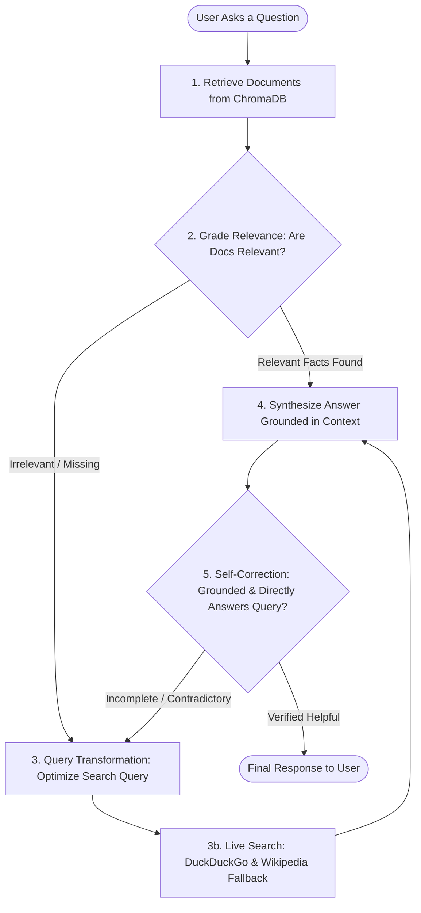

# 🤖 Adaptive RAG Agentic AI (LangGraph + Groq)

[](https://www.python.org/downloads/)
[](https://github.com/langchain-ai/langgraph)
[](https://groq.com/)
[](https://streamlit.io/)

An end-to-end **Agentic AI application** implementing an **Adaptive RAG (Retrieval-Augmented Generation)** loop using **LangGraph**, **Groq LPU cloud inference** (running open-weights models like `qwen/qwen3.8-27b`), and **local ChromaDB vector embeddings**.

Includes both a **Streamlit Web Application** and a **Command Line Interface (CLI)** with real-time execution tracing and self-correcting hallucination checks.

---

## 🏛️ How the LLM Agent Works (Architecture)

The agent does not simply generate an answer; it autonomously analyzes retrieval quality, rewrites bad queries, searches external sources when needed, and evaluates its own response for accuracy before presenting it to the user.



### The 5 Agent Stages:
1. **`retrieve`**: Searches local ChromaDB vector store using `sentence-transformers/all-MiniLM-L6-v2`.
2. **`grade_documents`**: The LLM evaluates whether retrieved documents contain factual context relevant to the user query.
3. **`transform_query` & `web_search`**: If internal documents lack context, the LLM generates a targeted search query and fetches live external information (via Wikipedia REST API & DuckDuckGo).
4. **`generate`**: Synthesizes a factual, coherent response grounded in verified sources.
5. **`grade_generation`**: Self-correction node checking if the generated answer directly answers the question without contradicting verified sources.

---

## ⚡ Quickstart Guide

### Step 1: Clone the Repository
```bash
git clone https://github.com/One-Hat/Agentic_Ai_Dump.git
cd Agentic_Ai_Dump
```

### Step 2: Set Up Python Virtual Environment
```bash
cd groq_langgraph_agent
python -m venv .venv

# On Windows (PowerShell):
.\.venv\Scripts\Activate.ps1

# On macOS/Linux:
source .venv/bin/activate
```

### Step 3: Install Dependencies
```bash
pip install -r requirements.txt
```

### Step 4: Configure Free Groq API Key
1. Get a free API key at **[console.groq.com/keys](https://console.groq.com/keys)** (free, no credit card required).
2. Copy the example configuration file:
   ```bash
   cp .env.example .env     # On Linux/macOS
   copy .env.example .env   # On Windows
   ```
3. Edit `.env` with your preferred settings:
   ```env
   GROQ_API_KEY=gsk_your_actual_key_here
   MODEL_NAME=qwen/qwen3.8-27b
   EMBEDDING_MODEL_ID=sentence-transformers/all-MiniLM-L6-v2
   ```

---

## 📖 How to Use the LLM Application

### 🌐 Method 1: Interactive Streamlit Web UI (Recommended)

Launch the web interface:
```bash
streamlit run app.py
```
Then open your browser to **http://localhost:8501**.

#### Web UI Highlights:
* **Real-time Trace Drawer**: Expand the live status box to watch the agent retrieve documents, grade relevance, optimize search queries, and verify output.
* **Source Inspector**: Inspect the exact context documents, URLs, and Wikipedia snippets used to formulate the answer.
* **Sidebar Controls**: View active model parameters, architectural diagram, and clear chat history.

---

### 💻 Method 2: Interactive Terminal Chat (CLI)

Run the CLI in continuous conversation mode:
```bash
python main.py
```
```text
======================================================================
   [AGENT] OPEN-SOURCE ADAPTIVE RAG AGENT (LANGRAPH)
   Provider : Groq (Free Cloud LPU)
   Model    : qwen/qwen3.8-27b
======================================================================

Entering interactive mode. Type 'exit' or 'quit' to stop.

Ask a question: What is LangGraph and how does it support cyclical agent workflows?
```

---

### 🚀 Method 3: Single Command Query

Pass your question directly from the terminal:
```bash
python main.py --query "Explain the difference between verse and prose in poetry."
```

---

### 📊 Method 4: Export Workflow Architecture Diagram

Output the Mermaid graph directly to your terminal:
```bash
python main.py --mermaid
```

---

### 🐍 Method 5: Integrate into Python Scripts

You can import and run the compiled LangGraph agent in your own Python projects:

```python
from graph import rag_app

initial_state = {
    "question": "What is LangGraph?",
    "original_question": "What is LangGraph?",
    "documents": [],
    "web_search": False,
    "generation": "",
    "iterations": 0
}

# Stream events step-by-step
for output in rag_app.stream(initial_state):
    for node_name, state_update in output.items():
        print(f"Step executed: [{node_name}]")

# Retrieve final generation
final_answer = output.get("generate", {}).get("generation")
print("\nFinal Answer:\n", final_answer)
```

---

## 🔧 Customizing the Agent

### Swapping LLM Models
You can change the model anytime in `.env` without modifying code:
* `qwen/qwen3.8-27b` *(Default - exceptional reasoning, high throughput)*
* `openai/gpt-oss-120b` *(Deep reasoning on open weights)*
* `openai/gpt-oss-20b` *(Fast, lightweight)*

### Adding Your Own Knowledge Base Documents
Open [`groq_langgraph_agent/tools.py`](file:///d:/Agentic_AI/groq_langgraph_agent/tools.py) and add new `Document` entries to `SAMPLE_DOCUMENTS`:
```python
SAMPLE_DOCUMENTS = [
    Document(
        page_content="Your company documentation or domain facts go here...",
        metadata={"source": "custom_doc.md", "topic": "Internal Knowledge"}
    ),
    # Add more documents here...
]
```
The ChromaDB vector store will index them with local embeddings.

---

## 📁 Repository Structure

```
Agentic_Ai_Dump/
├── README.md                      # Primary documentation (this file)
└── groq_langgraph_agent/          # Core Agent Package
    ├── app.py                     # Streamlit Web UI application
    ├── main.py                    # Terminal CLI runner with streaming traces
    ├── graph.py                   # LangGraph StateGraph & conditional routing
    ├── nodes.py                   # Node functions (retrieve, grade, transform, search, generate)
    ├── edges.py                   # Self-correction & decision edges
    ├── models.py                  # ChatGroq LLM & local sentence-transformers loader
    ├── tools.py                   # ChromaDB vector store & Wikipedia search fallback
    ├── state.py                   # GraphState TypedDict definition
    ├── config.py                  # Environment variable configuration
    ├── requirements.txt           # Python package requirements
    ├── .env.example               # Template for API keys
    └── .gitignore                 # Excludes local .env, .venv, and Chroma caches
```

---

## 🔒 Security & Privacy
* Your private API key (`.env`) is protected and ignored by `.gitignore`.
* Document embeddings run **100% locally on CPU** using `sentence-transformers`, ensuring private knowledge remains local unless external search fallback is explicitly triggered.
