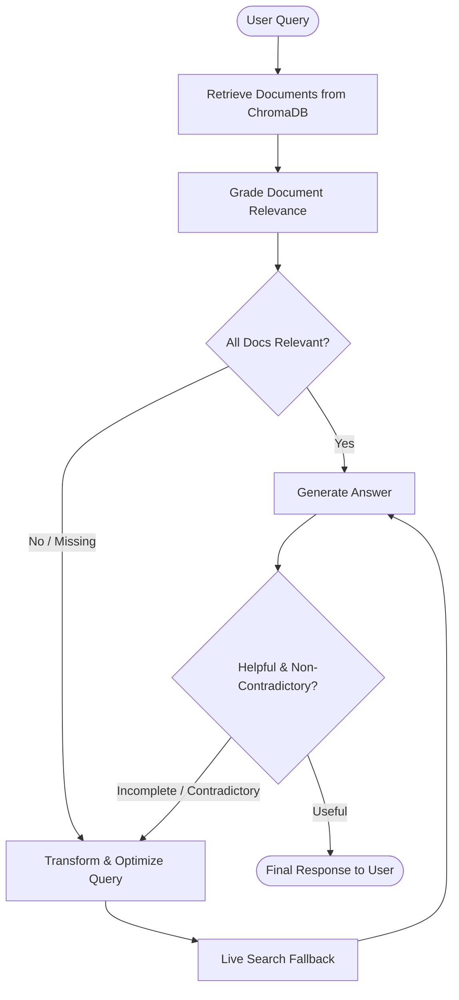

# 🤖 Open-Source Adaptive RAG Agent (LangGraph + Groq)

An agentic AI application built using **LangGraph** and open-source models (such as `qwen/qwen3.8-27b`) running on **Groq's high-speed free LPU inference**.

It implements an **Adaptive RAG (Retrieval-Augmented Generation)** pattern with automated relevance grading, dynamic query transformation, live web/encyclopedia search fallback, and self-correcting hallucination checks.

---

## 🏛️ Architecture



### Key Workflow Components:
1. **`retrieve`**: Vector similarity search using `sentence-transformers/all-MiniLM-L6-v2` against local ChromaDB.
2. **`grade_documents`**: The LLM evaluates whether each retrieved document contains facts relevant to the query.
3. **`transform_query`**: If documents are insufficient, the LLM reformulates the user question into an optimized search query.
4. **`web_search`**: Performs search fallback via DuckDuckGo and Wikipedia to obtain relevant context.
5. **`generate`**: Synthesizes a factual, grounded answer from retrieved context and general knowledge.
6. **`grade_generation`**: Self-correction loop ensuring the response directly answers the question without contradicting verified sources.

---

## 🚀 Quickstart Guide

### 1. Configure Your Free Groq Key
Get a free API key at [console.groq.com/keys](https://console.groq.com/keys) (no credit card needed).

Create your `.env` file from `.env.example`:
```env
GROQ_API_KEY=gsk_your_key_here
MODEL_NAME=qwen/qwen3.8-27b
EMBEDDING_MODEL_ID=sentence-transformers/all-MiniLM-L6-v2
```

### 2. Install Dependencies
```bash
pip install -r requirements.txt
```

### 3. Run the Agent
- **Interactive Mode**:
  ```bash
  python main.py
  ```
- **Single Query Mode**:
  ```bash
  python main.py --query "What is LangGraph and how does it support cyclical agent workflows?"
  ```
- **View Mermaid Diagram**:
  ```bash
  python main.py --mermaid
  ```
