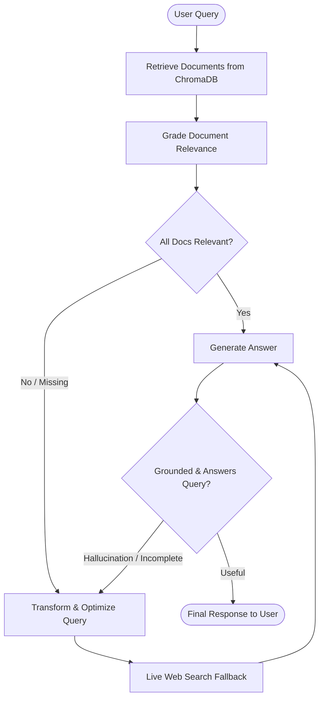

# 🧠 Open-Source Hugging Face + LangGraph Adaptive RAG Agent

An agentic AI application built using **LangGraph** and open-source models hosted on the **Hugging Face Serverless Inference API** (such as Qwen 2.5, Llama 3.1, and Mistral).

It implements an **Adaptive RAG (Retrieval-Augmented Generation)** pattern with automated relevance grading, dynamic query rewriting, live web-search fallback, and self-correcting hallucination checks.

---

## 🏛️ Architecture



### Key Workflow Components:
1. **`retrieve`**: Vector similarity search using `sentence-transformers/all-MiniLM-L6-v2` against local ChromaDB.
2. **`grade_documents`**: The Hugging Face LLM evaluates whether each retrieved document contains facts relevant to the query.
3. **`transform_query`**: If documents are insufficient, the LLM reformulates the user question into an optimized web-search query.
4. **`web_search`**: Performs live external search via DuckDuckGo to obtain up-to-date or missing context.
5. **`generate`**: Synthesizes a factual, grounded answer from all retrieved documents.
6. **`grade_generation`**: Self-correction loop checking for hallucinations and ensuring the user's initial question is directly answered.

---

## 🚀 Quickstart Guide

### 1. Set Up Python Virtual Environment
Navigate to the project folder and create a virtual environment:

```bash
cd d:\Agentic_AI\hf_langgraph_agent
python -m venv .venv
# Activate on Windows (PowerShell):
.venv\Scripts\Activate.ps1
# Activate on Windows (Command Prompt):
.venv\Scripts\activate.bat
```

### 2. Install Dependencies
```bash
pip install -r requirements.txt
```

### 3. Configure Hugging Face Token
Create your `.env` file from `.env.example`:

```bash
copy .env.example .env
```

Edit `.env` and set your token:
```env
HUGGINGFACEHUB_API_TOKEN=hf_your_actual_token_here
HF_MODEL_ID=Qwen/Qwen2.5-72B-Instruct
EMBEDDING_MODEL_ID=sentence-transformers/all-MiniLM-L6-v2
```

> **Where to get a token?**  
> Generate a free Access Token at [Hugging Face Settings -> Tokens](https://huggingface.co/settings/tokens).

---

## 💻 Running the Application

### Interactive Mode
```bash
python main.py
```
Type any question and observe the agent trace each node in real-time.

### Single Query Mode
```bash
python main.py --query "What is LangGraph and how does it support cyclical agent workflows?"
```

### View Architecture Diagram (Mermaid)
```bash
python main.py --mermaid
```

---

## 🛠️ File Structure

| File | Purpose |
| :--- | :--- |
| [`main.py`](file:///d:/Agentic_AI/hf_langgraph_agent/main.py) | CLI entry point, streaming event loop, and banner display |
| [`graph.py`](file:///d:/Agentic_AI/hf_langgraph_agent/graph.py) | Assembles the LangGraph `StateGraph`, nodes, and conditional edges |
| [`nodes.py`](file:///d:/Agentic_AI/hf_langgraph_agent/nodes.py) | Node execution logic: retrieve, grade, transform, search, generate |
| [`edges.py`](file:///d:/Agentic_AI/hf_langgraph_agent/edges.py) | Routing functions & self-correction evaluation logic |
| [`models.py`](file:///d:/Agentic_AI/hf_langgraph_agent/models.py) | Hugging Face Chat LLM and sentence-transformers embeddings setup |
| [`tools.py`](file:///d:/Agentic_AI/hf_langgraph_agent/tools.py) | Chroma vector store & DuckDuckGo search fallback |
| [`state.py`](file:///d:/Agentic_AI/hf_langgraph_agent/state.py) | Definition of `GraphState` TypedDict |
| [`config.py`](file:///d:/Agentic_AI/hf_langgraph_agent/config.py) | Environment variables and configuration loaders |
| [`requirements.txt`](file:///d:/Agentic_AI/hf_langgraph_agent/requirements.txt) | Python dependencies |

---

## 🔧 Supported Hugging Face Models
You can swap models in `.env` anytime without modifying code:
- `Qwen/Qwen2.5-72B-Instruct` *(Default - exceptional reasoning & structured output)*
- `meta-llama/Llama-3.1-8B-Instruct` *(Fast, balanced performance)*
- `mistralai/Mistral-7B-Instruct-v0.3` *(Compact and versatile)*
